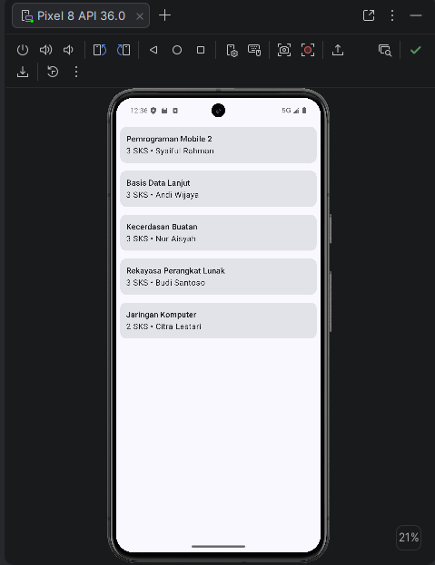
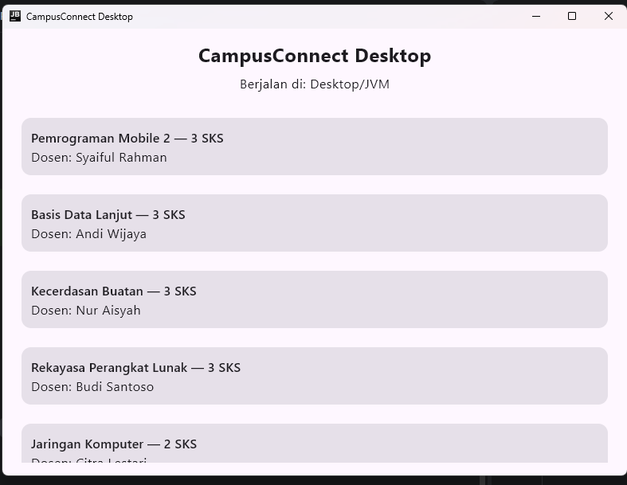
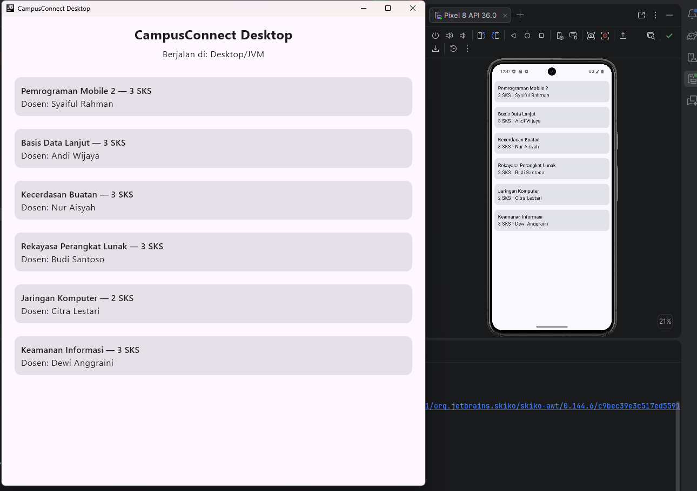

# Progress Pertemuan 2 - Kotlin Multiplatform

Nama: Andi Muh Rafi Khairan
NIM: 52024002

## Yang dikerjakan
- Membuat modul `:shared` (KMP) dengan target Android dan Desktop.
- Memindahkan `MataKuliah` ke `commonMain` dan membuat `CourseRepository` beserta `CourseRepositoryImpl` sebagai satu-satunya sumber data.
- Membuat `getPlatformName()` dengan expect/actual: "Android" di `androidMain` dan "Desktop/JVM" di `desktopMain`.
- Menghubungkan modul `:app` ke `:shared` dan menghapus `DummyData.kt`.
- Membuat modul `:desktopApp` untuk menampilkan daftar mata kuliah di jendela Desktop.

## Tampilan Android

## Tampilan Desktop

## Uji konsistensi data
Saya menambahkan satu mata kuliah (id 6) hanya di `CourseRepositoryImpl` pada modul `:shared`. Mata kuliah tersebut langsung muncul di Android dan Desktop tanpa mengubah kode lain, sehingga terbukti `:shared` adalah satu-satunya sumber data. Setelah itu data dikembalikan ke 5 item.

## Kesimpulan
Dengan memisahkan data ke modul `:shared`, logika yang sama bisa dipakai oleh Android dan Desktop tanpa menulis ulang. Expect/actual memungkinkan kode berbeda per platform tetap aman karena dicek saat compile.