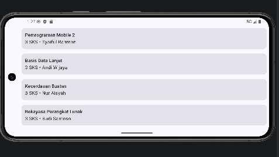

---

# Pertemuan 4 - MVVM, Clean Architecture, dan Hilt

## Yang dikerjakan
- Menambahkan Hilt (`@HiltAndroidApp`, `@AndroidEntryPoint`, `@Module`) untuk dependency injection.
- Membuat layer domain: `GetCoursesUseCase`.
- Membuat `HomeViewModel` yang menyimpan daftar mata kuliah dalam `StateFlow`.
- `HomeScreen` hanya menampilkan data dari ViewModel.
- Aturan baru: presentation tidak boleh memanggil repository langsung, harus lewat UseCase.

## Alur arsitektur
```
HomeScreen -> HomeViewModel -> GetCoursesUseCase -> CourseRepository <- CourseRepositoryImpl
(presentation)  (presentation)    (domain)           (interface)         (data, modul :shared)

Hilt (di/AppModule) menyuntikkan dependensi di setiap sambungan.
```

## Struktur paket modul :app
presentation (HomeScreen, HomeViewModel), domain (GetCoursesUseCase), di (AppModule), ui/theme.

## Hasil
Tampilan aplikasi sama persis dengan sebelum refactor.

