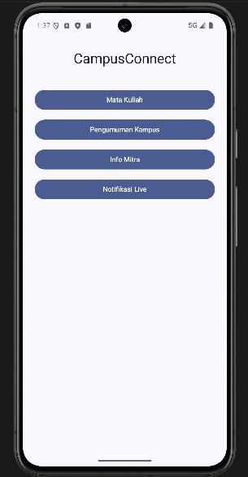
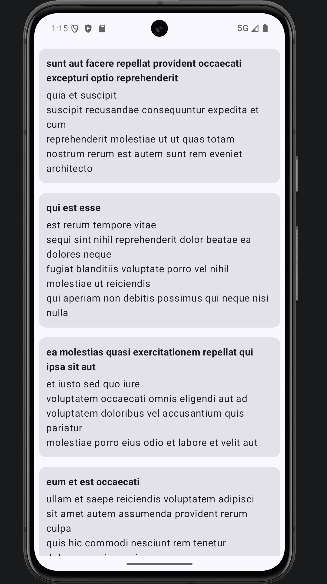
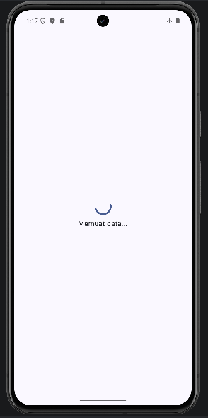
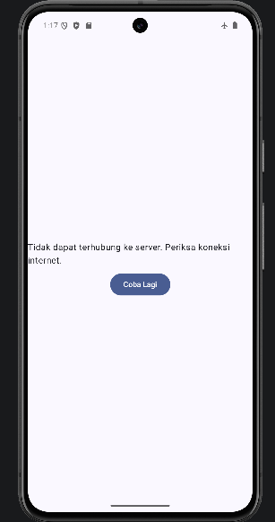
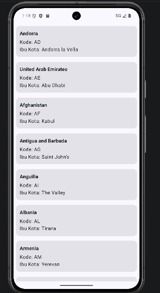
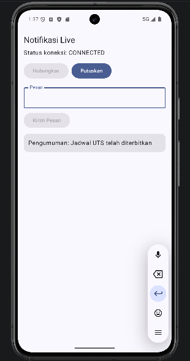
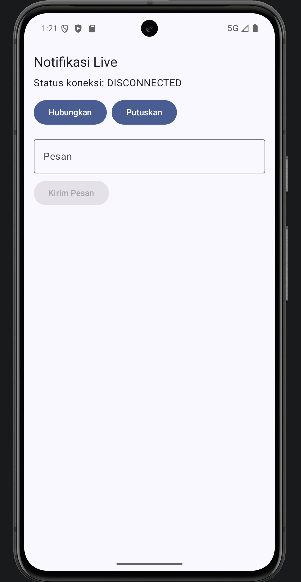

---

# Pertemuan 5 - Integrasi REST, GraphQL, dan WebSocket

## Yang dikerjakan
- **Pengumuman Kampus** memakai REST API (Retrofit + Gson) dari JSONPlaceholder. Ada kondisi loading, success, error, dan tombol "Coba Lagi".
- **Info Mitra** memakai GraphQL (Apollo Kotlin) dari countries.trevorblades.com. Query hanya meminta field `name`, `code`, dan `capital`.
- **Notifikasi Live** memakai WebSocket (OkHttp) ke server echo. Ada status koneksi, kolom pesan, dan pesan terbaru tampil paling atas.
- **Navigasi**: menu utama berisi Mata Kuliah, Pengumuman Kampus, Info Mitra, dan Notifikasi Live.
- Arsitektur tetap mengikuti aturan Pertemuan 4: presentation tidak memanggil repository langsung, tetapi lewat UseCase.

## Alur komunikasi
```
Screen -> ViewModel -> UseCase -> Repository (interface) <- RepositoryImpl -> Retrofit / Apollo -> Server

Screen -> ViewModel -> NotificationSocketManager -> WebSocket (koneksi dua arah)
```

## Perbedaan REST, GraphQL, dan WebSocket di CampusConnect

| | REST | GraphQL | WebSocket |
|---|---|---|---|
| Fitur | Pengumuman Kampus | Info Mitra | Notifikasi Live |
| Pola komunikasi | Request-response, endpoint per resource | Query ke satu endpoint, client memilih field | Koneksi dua arah yang tetap terbuka |
| Library | Retrofit | Apollo Kotlin | OkHttp WebSocket |
| Kelebihan | Sederhana dan umum dipakai | Hanya mengambil field yang dibutuhkan | Server bisa mengirim data kapan saja tanpa refresh |
| Cocok untuk | Mengambil daftar data | Data yang kebutuhan field-nya berbeda-beda | Notifikasi dan pesan real-time |

## Hasil pengujian

| No | Fitur | Skenario | Hasil |
|---|---|---|---|
| 1 | REST | Buka Pengumuman dengan internet aktif | Berhasil, daftar pengumuman tampil |
| 2 | REST | Buka Pengumuman saat koneksi terputus (airplane mode) | Berhasil, pesan error dan tombol "Coba Lagi" tampil |
| 3 | REST | Tekan "Coba Lagi" setelah koneksi pulih | (isi setelah diuji) |
| 4 | GraphQL | Buka Info Mitra dengan internet aktif | Berhasil, nama, kode, dan ibu kota negara tampil |
| 5 | GraphQL | Server tidak dapat diakses | (isi setelah diuji) |
| 6 | WebSocket | Hubungkan ke server echo | Berhasil, status CONNECTED |
| 7 | WebSocket | Kirim pesan | Berhasil, pesan kembali dari server dan tampil di daftar |
| 8 | WebSocket | Kirim beberapa pesan | (isi setelah diuji: pesan terbaru di paling atas) |
| 9 | WebSocket | Putuskan koneksi | Berhasil, status DISCONNECTED |

Catatan: data pengumuman berasal dari JSONPlaceholder, jadi isinya teks contoh, bukan pengumuman kampus sebenarnya.

## Catatan server WebSocket
Server echo yang dipakai: (isi alamat yang berhasil, misalnya wss://...). Server contoh dari modul sempat gagal dihubungi (status ERROR), jadi alamat diganti ke server echo lain yang bisa diakses dari jaringan yang saya pakai.

## Screenshot

### Menu utama


### Pengumuman Kampus (REST)


Kondisi loading:



Kondisi error:



### Info Mitra (GraphQL)


### Notifikasi Live (WebSocket)
Terhubung dan pesan diterima:



Setelah diputuskan:



## Kesimpulan
(Tulis 2-3 kalimat dengan kata-katamu sendiri: kapan REST, GraphQL, dan WebSocket sebaiknya dipakai, dan apa yang kamu pelajari dari menangani kondisi loading, error, dan koneksi yang terputus.)